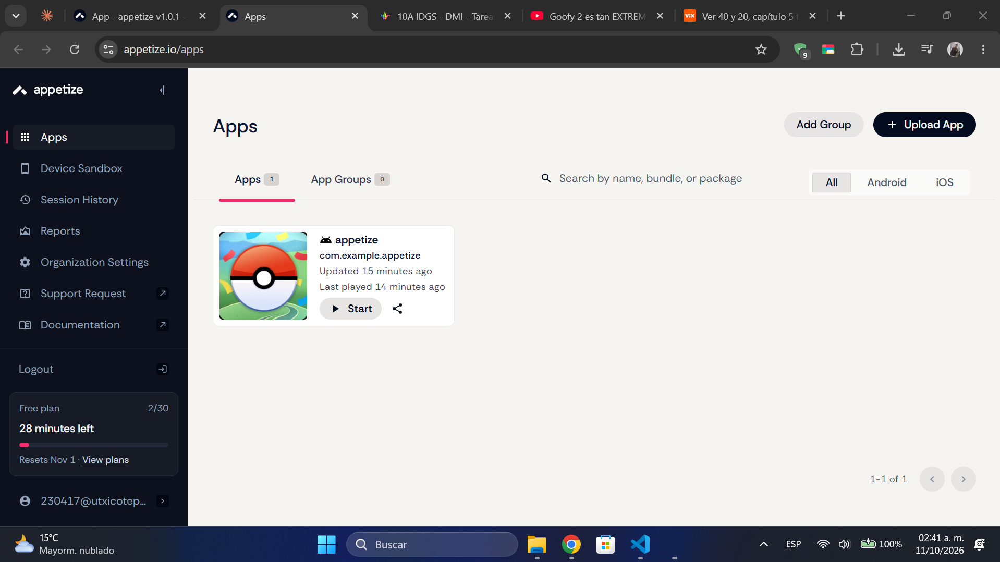
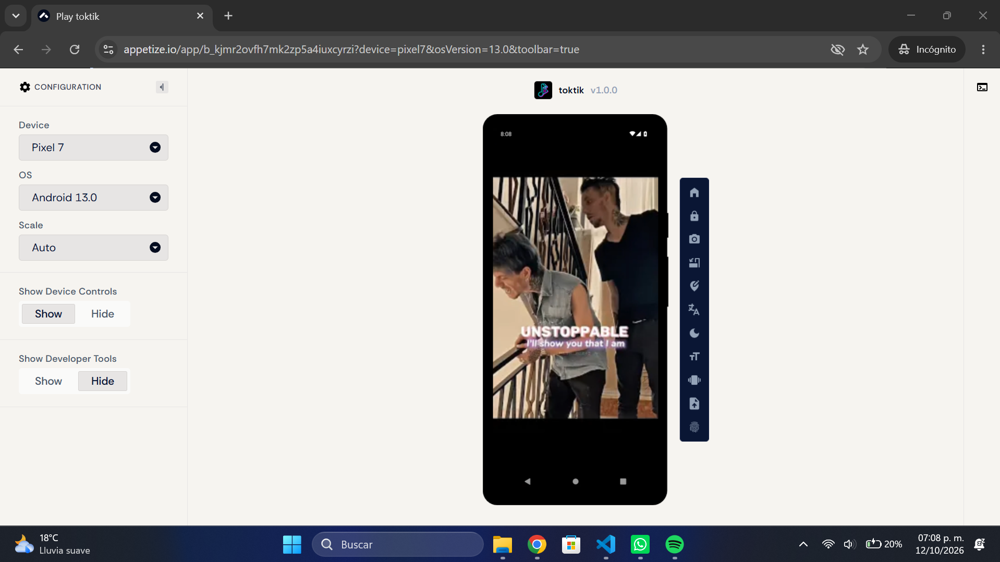
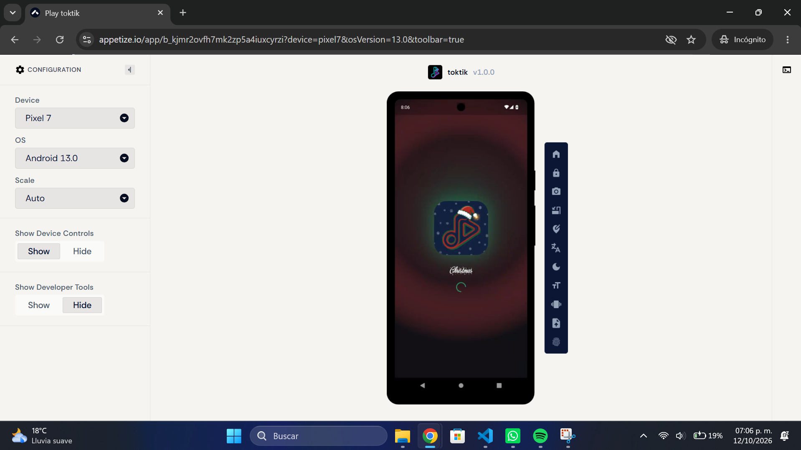
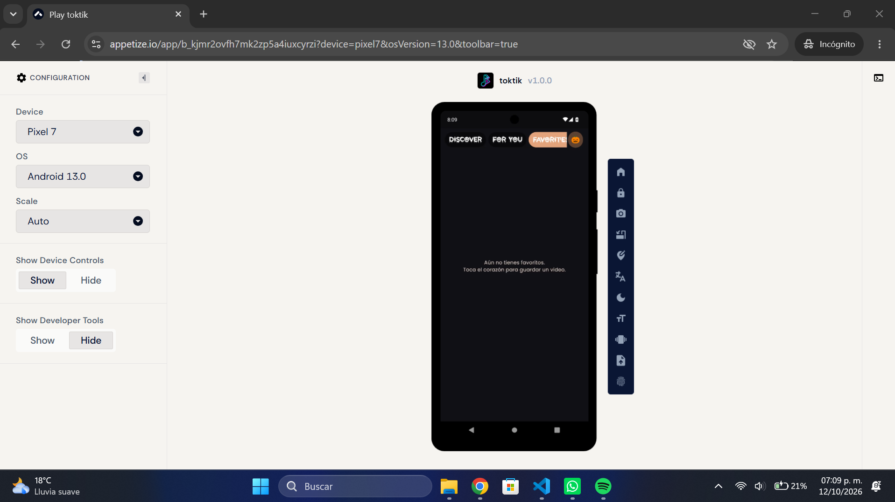
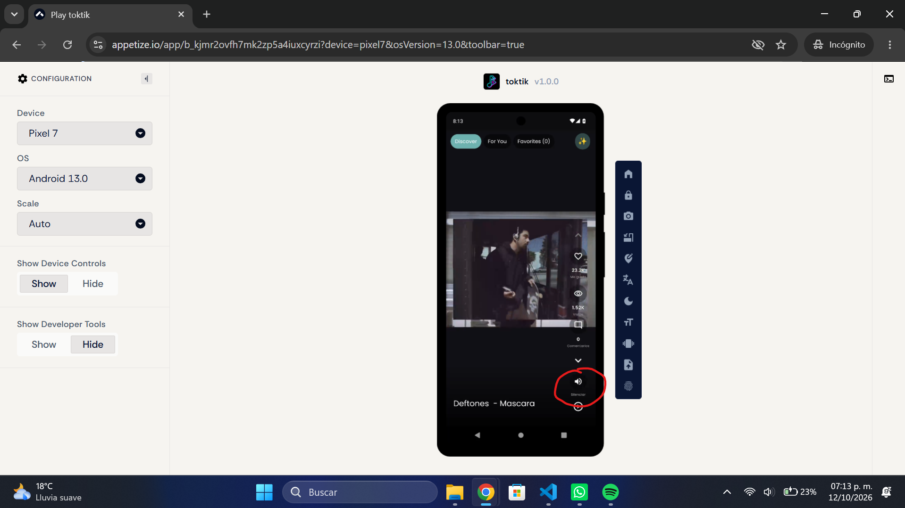

## Pruebas funcionales en Appetize

La evidencia de Appetize corresponde a la validación en la nube de la aplicación TokTik v1.0.0 compilada en release (`build/app/outputs/flutter-apk/app-release.apk`) y a la aplicación complementaria Pokédex Mini.

**Aplicación:** TokTik v1.0.0  
**Dispositivo de referencia:** Pixel 7 — Android 13.0  
**Enlace público TokTik:** [https://appetize.io/app/b_kjmr2ovfh7mk2zp5a4iuxcyrzi](https://appetize.io/app/b_kjmr2ovfh7mk2zp5a4iuxcyrzi)  
**Proyecto complementario Appetize (Pokédex Mini):** [Ver documentación y código de Pokédex Mini](./appetize/README.md) *(Enlace Appetize: https://appetize.io/app/b_z6febjqdrw5njy6kwfhrxeubbq)*

---

### Cómo generar y subir el APK

Desde `Practica04/toktik`:

```bash
flutter pub get
flutter analyze
flutter build apk --release
```

El archivo generado se ubica en `build/app/outputs/flutter-apk/app-release.apk`. En Appetize: **Apps → Upload → elegir dispositivo (Pixel 7 - Android 13.0) → Start → Share → Play URL**.




---

### 1. Carga de las APIs

**Objetivo:** comprobar que la app consume correctamente los servicios externos (YouTube Data API v3, GIPHY y Dailymotion) en modo release.  
**Pasos:** abrir la app y esperar a que cargue el contenido del feed.  
**Resultado esperado:** aparecen los videos con su información; un proveedor con incidencias no bloquea el feed ni muestra pantalla vacía.



---

### 2. Pantalla de carga (splash)

**Objetivo:** verificar la pantalla de bienvenida al abrir la app y la animación correspondiente al cambiar de tema de temporada.  
**Pasos:** abrir la app y observar la pantalla inicial; posteriormente cambiar el tema (Halloween / Navidad / San Valentín).  
**Resultado esperado:** se muestra el splash animado con el ícono y color de la temática antes de cargar el feed.




---

### 3. APK subido a Appetize

**Objetivo:** evidenciar que el APK de release fue procesado y publicado con éxito en la plataforma.  
**Pasos:** subir `app-release.apk` en Appetize (**Apps → Upload**) y abrir la página del build.  
**Resultado esperado:** la app aparece con su nombre, versión y fecha de carga, y el enlace público funciona de manera fluida.


---

### 4. Favoritos (likes y persistencia local)

**Objetivo:** comprobar que los likes se guardan en Favoritos y sobreviven al reabrir la app mediante SharedPreferences.  
**Pasos:**
1. Dar like a uno o varios videos del feed vertical.
2. Abrir la vista de Favoritos y verificar que aparezcan.
3. Cerrar la app desde recientes y volver a abrirla **sin cerrar la sesión de Appetize**.
4. Revisar de nuevo la sección de Favoritos.

**Resultado esperado:** los videos marcados con like continúan presentes en Favoritos.




> **Nota:** En una sesión nueva de Appetize el contenedor arranca en un estado limpio, por lo que la persistencia se valida dentro de la misma sesión activa.

---

### 5. Mostrar más contenido (título y descripción)

**Objetivo:** verificar la visualización expandida de la información completa del video.  
**Pasos:** en cualquier video en reproducción, presionar «mostrar más».  
**Resultado esperado:** se despliega el título completo y la descripción detallada del video.


---

### 6. Botón de pausa

**Objetivo:** comprobar que la reproducción de video se pause y reanude correctamente al interactuar con el control.  
**Pasos:** presionar el botón de pausa durante la reproducción y tocarlo nuevamente.  
**Resultado esperado:** el video se detiene inmediatamente y el ícono cambia; al volver a tocarlo, continúa la reproducción.


---

### 7. Botón de silenciar

**Objetivo:** comprobar que el audio del video se silencie y reactive adecuadamente.  
**Pasos:** presionar el botón de volumen durante la reproducción y volver a presionarlo.  
**Resultado esperado:** el canal de audio se silencia y el ícono cambia; al presionarlo de nuevo se restaura el volumen.



---

## Práctica complementaria: Pokédex Mini en Appetize

Además de TokTik, se integró y validó la aplicación **Pokédex Mini** en Appetize, probando adaptabilidad multidispositivo (Pixel 11 Pro y Tablet), consumo de PokeAPI, formulario con validaciones y control de versiones con ramas y pull requests.

- [Ir a la documentación completa de Pokédex Mini](./appetize/README.md)
- [Diagrama interactivo de arquitectura](./appetize/docs/arquitectura.html)

## Autor

- Edgar Cabrera (230496)
