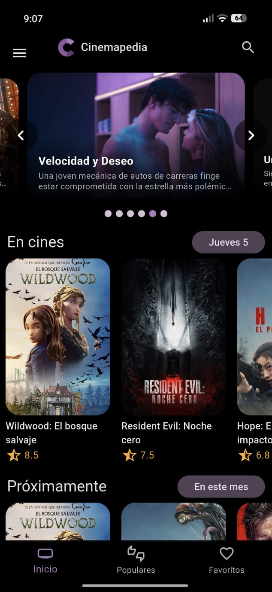
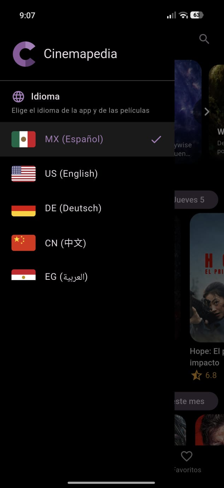
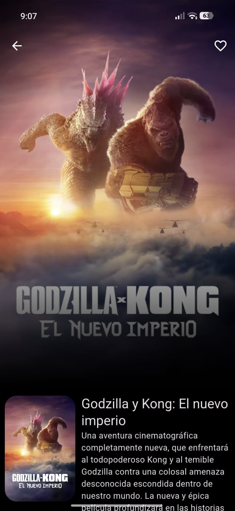
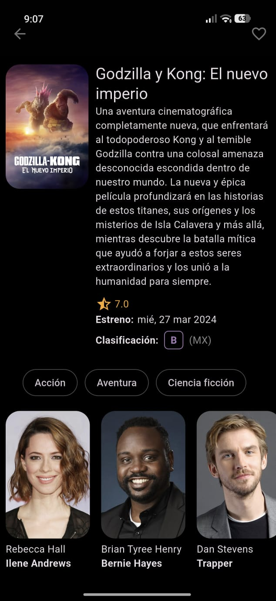
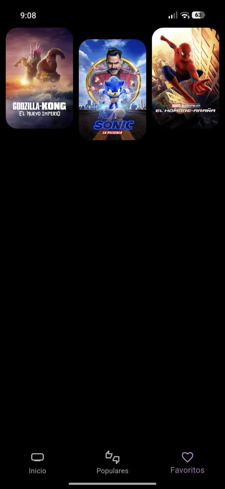
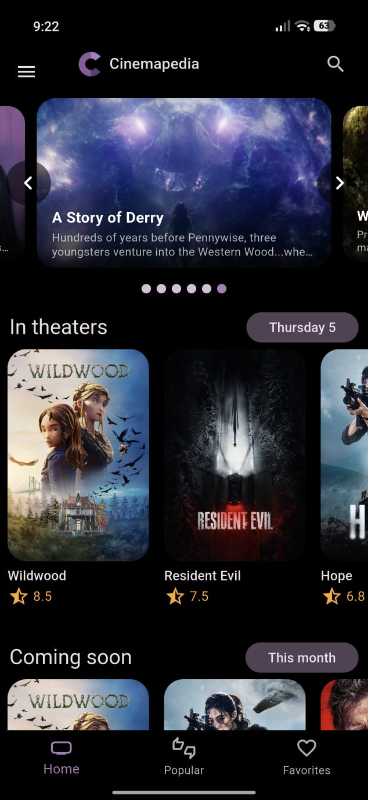
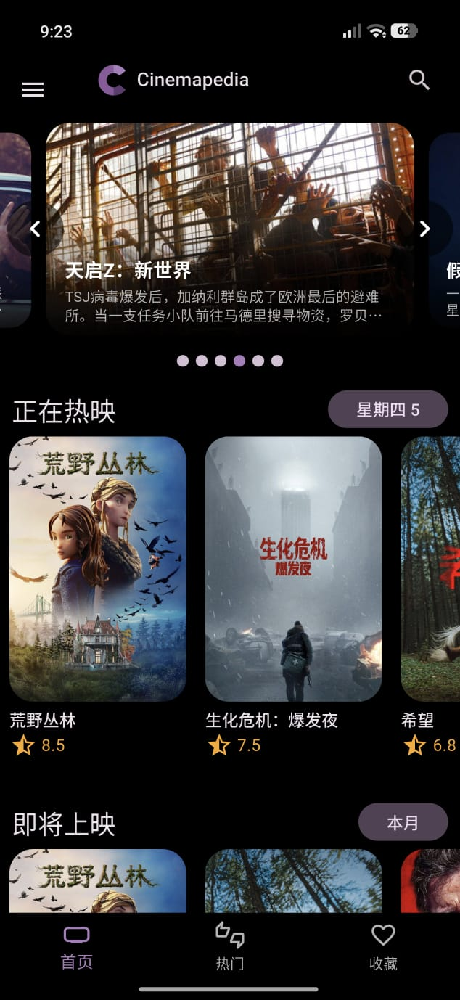
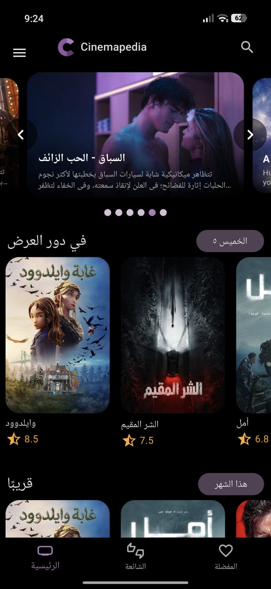
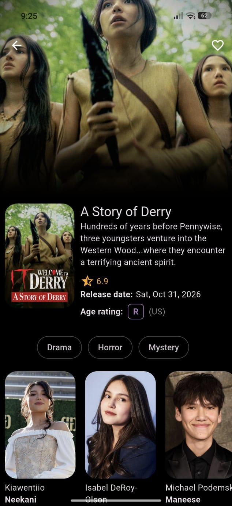
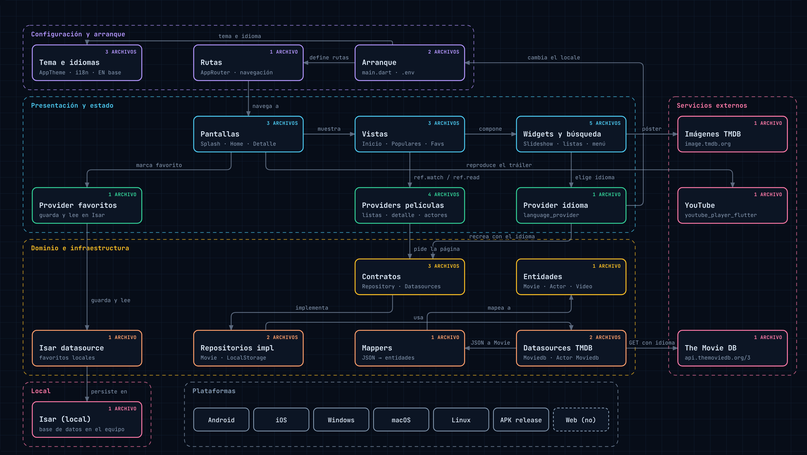

<div align="center">


# Cinemapedia

**Tu enciclopedia de cine, en una sola app.**  
Descubre qué hay en cines, qué viene pronto y qué películas son las mejor calificadas, en 5 idiomas.


</div>

## Sobre la app

**Cinemapedia** es una aplicación multiplataforma desarrollada con Flutter que consume la API de [The Movie DB](https://www.themoviedb.org/). Permite explorar las películas en cartelera, próximos estrenos, películas más populares y mejor calificadas, visualizando el detalle de cada película con su sinopsis, reparto de actores, tráilers de YouTube y películas similares.

La app cuenta con **soporte multi-idioma para 5 regiones**:
- 🇲🇽 **Español (México)**
- 🇺🇸 **Inglés (Estados Unidos)**
- 🇩🇪 **Alemán (Alemania)**
- 🇨🇳 **Chino (China)**
- 🇪🇬 **Árabe (Egipto)**

El idioma se puede cambiar dinámicamente desde el menú lateral (`SideMenu`), traduciendo tanto las cadenas de la interfaz como los datos obtenidos de la API de TMDB.

## Nuevo Logotipo e Identidad Visual

Para esta entrega se diseñó un **nuevo logotipo e identidad visual** denominado **"Cinematic Nexus"**:
- **Emblema central:** Prisma de reproducción ("Play") luminoso con degradados en tonos cian, violeta y fucsia cinematográfico.
- **Escudo exterior:** Polígono hexagonal facetado con muescas superiores de claqueta de cine.
- **Animación:** Renderizado vectorial mediante `CustomPainter` en [`CinemapediaLogo`](./lib/presentation/widgets/shared/cinemapedia_logo.dart) con soporte de `progress`, trazando el escudo y encendiendo el prisma de reproducción de forma fluida durante el `SplashScreen`.
- **Iconos generados:** Disponible en alta resolución (`1024x1024`), variantes de primer plano (`ic_launcher_foreground`), iconos monocromáticos y mipmaps completos para Android, Web y macOS.

## Capturas de Pantalla

<div align="center">

| Pantalla de carga | Inicio y navegación | Menú Lateral |
| :---: | :---: | :---: |
|  |  |  |

| Detalles de Película | Elenco | Favoritos |
| :---: | :---: | :---: |
|  |  |  |

</div>

### Soporte Multi-idioma

<div align="center">

| MX (Español) | US (English) | DE (Deutsch) |
| :---: | :---: | :---: |
|  |  |  |

| CN (中文) | EG (العربية) | Clasificación |
| :---: | :---: | :---: |
|  |  |  |

</div>

## Funcionalidades Principales

- **Pantalla de Splash Animada:** Logotipo vectorial interactivo que se dibuja en pantalla con zoom cinematográfico hacia la interfaz principal.
- **Carrusel de Estrenos Interactivo:** 
  - Muestra imagen de fondo con degradado, título y descripción corta.
  - **Navegación con flechas:**
    - **1 clic:** Avanza o retrocede 1 película.
    - **Doble clic:** Salta directamente al inicio (película 1) o al final (última película).
- **Listas Horizontales Infinitas:** Secciones *En cines*, *Próximamente* y *Mejor calificadas* con paginación automática y debounce.
- **Vista de Cuadrícula (Masonry):** Pestaña de películas Populares con diseño escalonado.
- **Detalle de Película Completo:** Sinopsis, géneros, reparto con foto de actores, tráilers de YouTube embebidos, clasificación por edad según el país y recomendaciones de películas similares.
- **Búsqueda en Tiempo Real:** Delegado de búsqueda con debouncer de 500ms y sugerencias interactivas.
- **Favoritos Locales:** Almacenamiento local persistente con base de datos NoSQL **Isar Community**.
- **Menú Lateral (`Drawer`):** Selector interactivo con banderas para cambiar de idioma al instante.

## Arquitectura del Proyecto

El proyecto sigue los principios de **Clean Architecture** dividiéndose en capas desacopladas:
1. **Dominio:** Entidades (`Movie`, `Actor`, `Video`) y contratos de fuentes de datos y repositorios.
2. **Infraestructura:** Modelos de API (`The Movie DB`), mappers y datasources concretos (HTTP con Dio y local con Isar).
3. **Presentación:** Pantallas, vistas, widgets modulares y gestores de estado con **Riverpod**.

El diagrama interactivo de arquitectura se encuentra disponible en:
- [`../Arquitectura/Arquitectura_de_Cinemapedia.html`](../Arquitectura/Arquitectura_de_Cinemapedia.html)

<div align="center">



</div>

## Tecnologías Utilizadas

| Categoría | Paquete / Tecnología |
| :--- | :--- |
| **Gestión de Estado** | `flutter_riverpod` (v2.6.1) |
| **Enrutamiento** | `go_router` (v17.5.0) |
| **Cliente HTTP** | `dio` (v5.11.1) |
| **Base de Datos Local** | `isar_community` / `isar_community_flutter_libs` (v3.4.1) |
| **Carrusel** | `card_swiper` (v3.0.1) |
| **Animaciones** | `animate_do` (v4.2.0) |
| **Cuadrícula** | `flutter_staggered_grid_view` (v0.7.0) |
| **Reproductor de Video** | `youtube_player_flutter` (v10.0.1) |
| **Variables de Entorno** | `flutter_dotenv` (v5.2.1) |
| **Localización e Idiomas** | `flutter_localizations` e `intl` (v0.20.2) |

## Configuración y Ejecución

1. Clonar el repositorio y ubicarse en el directorio del proyecto:
   ```bash
   cd Practica06/cinemapedia
   ```

2. Configurar la clave de API en `.env`:
   ```env
   THE_MOVIEDB_KEY=tu_api_key_de_the_moviedb
   ```

3. Obtener las dependencias:
   ```bash
   flutter pub get
   ```

4. Ejecutar la aplicación:
   ```bash
   flutter run
   ```

## Estudiante y Créditos

- **Estudiante:** Edgar Cabrera
- **Matrícula:** 230496
- **Carrera:** Ingeniería en Desarrollo y Gestión de Software
- **Materia:** Desarrollo Móvil Integral
- **Docente:** M.T.I. Marco A. Ramírez Hernández
- **Datos de Películas:** Proporcionados por [The Movie DB API](https://www.themoviedb.org/).
